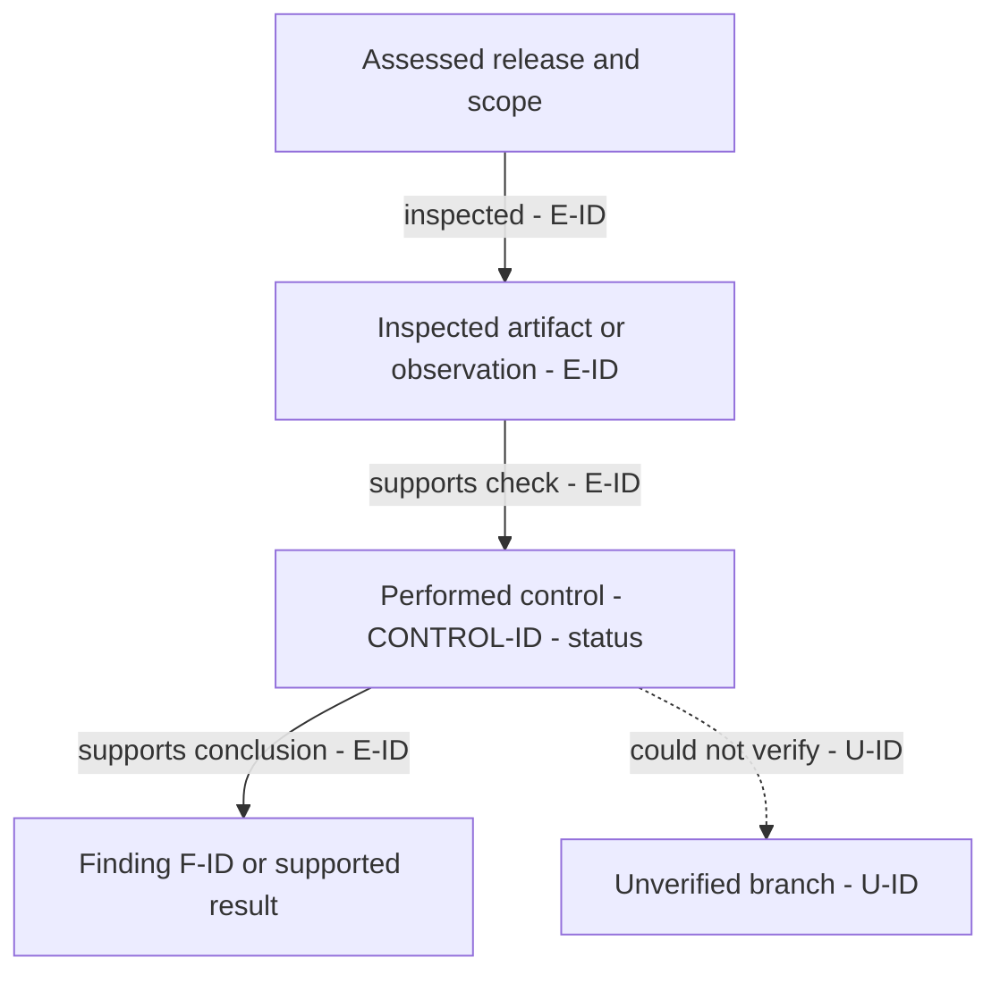
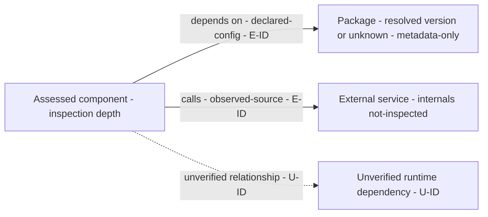

# Security readiness assessment — {{project}}

> Authoring instructions: replace every `{{...}}` field and every illustrative graph node/edge with actual audit records. Remove this instruction block before delivery. Keep both graph sections and their accessible tables. If a section has no findings or applicable items, explain why rather than inventing examples. Use the evidence, status, graph, and readiness contracts in the skill references.

| Assessment metadata | Value |
| --- | --- |
| Report ID / date / timezone | {{identifier; date; timezone}} |
| Assessor / method | {{agent or reviewer; source/config/runtime/document review performed}} |
| Repository and revision | {{repository; branch if relevant; exact commit; dirty/untracked scope}} |
| Release artifact | {{digest/version or unknown}} |
| Target environments | {{environment/service/provider; observed versus intended}} |
| Previous assessment | {{link and revision, or first assessment}} |
| Intended readers / disclosure scope | {{audience; sensitive identifiers redacted as appropriate}} |

## 1. Executive assessment

**Recommendation: {{BLOCKED / INSUFFICIENT EVIDENCE / READY WITH CONDITIONS / NO BLOCKER FOUND IN REVIEWED SCOPE}}**

{{Explain the recommendation in plain language, grounded in the specific release, known issues, and evidence limits. State that this is a bounded assessment, not a deployment authorization or compliance certification.}}

| Release decision item | Evidence / record | Required action or condition |
| --- | --- | --- |
| {{known blocker, critical unknown, or explicit none found}} | {{F-ID / U-ID / E-ID}} | {{concrete action; decision owner or unassigned}} |

**Material impact:** {{affected data, identities, customer separation, money, availability, or operations; label unknown assumptions}}.

**Coverage limit:** {{critical unreviewed surfaces, sampling, unavailable runtime evidence, stale advisory data, or failed checks}}.

If counts are useful, report confirmed findings and provisional leads separately by severity. State the applicable-control denominator and exclusions for any coverage count; do not turn these counts into a security score.

## 2. Calibrated context

| Topic | Answer | Basis and source | Audit consequence / unanswered follow-up |
| --- | --- | --- | --- |
| Product and critical actions | {{answer}} | {{basis; E-ID or user statement}} | {{modules/impact}} |
| Hosting and deployment model | {{provider; named services; VM/PaaS/serverless/container/etc.}} | {{basis; source}} | {{responsibility boundary}} |
| Components and environments | {{frontend/API/jobs/stores; dev/staging/prod}} | {{basis; source}} | {{separation/exposure}} |
| Users, roles, and tenants | {{answer}} | {{basis; source}} | {{permission cases}} |
| Data, integrations, and AI | {{answer}} | {{basis; source}} | {{sensitivity and trust boundaries}} |
| Identity and machine access | {{answer}} | {{basis; source}} | {{relevant identity flows}} |
| Delivery and operations | {{answer}} | {{basis; source}} | {{release/detection/recovery checks}} |
| Requirements and release criteria | {{confirmed requirements; date; decision owner}} | {{basis; source}} | {{criteria or applicability unknowns}} |

Add rows for relevant conditional answers. Record unknowns explicitly and link material ones to the unknowns register.

## 3. Scope and methods

### Target and authorization

- Included components and revisions: {{list}}.
- Permitted environments, identities, and methods: {{existing authorization and boundaries}}.
- Active-test limits and stop conditions, if applicable: {{rate, data, allowed effects, boundaries}}.
- Exclusions and reasons: {{including specialist surfaces outside supported coverage}}.
- Changes during the audit: {{new answers, target changes, or none}}.

### Module selection

| Module | Included / excluded / not verified | Reason and applicable surfaces |
| --- | --- | --- |
| {{one row for each of the nine modules}} | {{selection}} | {{evidence-backed reason or gap}} |

### Checks performed

| Check / technique | Tool and version or manual method | Target and evidence | Result | Limits |
| --- | --- | --- | --- | --- |
| {{source trace / configuration review / advisory lookup / runtime test}} | {{tool/rules/data date, if applicable}} | {{target; E-ID}} | {{completed / partial / failed / skipped}} | {{specific limitation}} |

State which checks did not run and why. Reading a test file is not executing it; loading an SDK is not checking its provider settings.

## 4. Control coverage

| Control ID | Surface / target | Status | Evidence | Finding / unknown | Coverage limits |
| --- | --- | --- | --- | --- | --- |
| {{module control ID}} | {{specific component/path/environment}} | {{satisfied / finding / needs-validation / not-verified / not-applicable}} | {{E-IDs}} | {{F-IDs / U-IDs or none}} | {{sampled paths; unavailable evidence; N/A reason}} |

Use separate rows for different outcomes across environments or surfaces. Preserve selected controls that could not be checked.

## 5. Analysis path graph

This graph records inspected artifacts, performed checks, evidence-backed results, and unresolved branches. It describes observable work and conclusions, not private reasoning. Edge order does not assert chronology.

**Graph validation:** {{locally rendered / parsed / syntax-reviewed only; method and result}}.

The following is a structural example to replace with the actual audit path:

### Analysis nodes

| Node ID | Type | Actual artifact / check / result | Target and status | Evidence / finding / unknown |
| --- | --- | --- | --- | --- |
| A_SCOPE | scope | {{release boundary}} | {{target}} | {{scope evidence}} |
| A_ARTIFACT | evidence | {{file and lines or observation}} | {{basis and target}} | {{E-ID}} |
| A_CHECK | check | {{control actually examined}} | {{control status}} | {{E-IDs}} |
| A_RESULT | result | {{supported conclusion}} | {{confirmation state where applicable}} | {{F-ID or evidence for a supported result}} |
| A_GAP | gap | {{unverified branch}} | {{not-verified / needs-validation}} | {{U-ID}} |

### Analysis edges

| From | To | Relationship | Evidence basis / IDs | Limit or gap |
| --- | --- | --- | --- | --- |
| A_SCOPE | A_ARTIFACT | inspected | {{basis; E-ID}} | {{scope limitation}} |
| A_ARTIFACT | A_CHECK | supports check | {{basis; E-ID}} | {{sampling or none}} |
| A_CHECK | A_RESULT | supports conclusion | {{basis; E-ID}} | {{inference boundary}} |
| A_CHECK | A_GAP | could not verify | {{available evidence or unavailable}} | {{U-ID; required next evidence}} |

## 6. Analyzed dependency graph

**Inventory boundary:** {{manifests, lockfiles, artifacts/SBOMs, source imports, deployment configurations, or runtime observations inspected}}.

**Coverage:** {{known inventory size if available; analyzed subset; selection rationale; omitted transitive/platform/provider internals}}.

**Graph validation:** {{locally rendered / parsed / syntax-reviewed only; method and result}}.

An edge describes a relationship, not a security verdict. Solid edges have a stated supporting basis; dashed edges are inferred or unverified. An external dependency can have an evidenced call relationship while its internals remain uninspected.

Replace this structural example with actual dependencies. Split runtime/service and package/build views if that improves readability; keep the same register and unique node IDs.

### Dependency nodes and analyzed package inventory

| Node ID | Component / package | Type and version | Role / environment / boundary | Inspection depth | Evidence | Findings / gaps |
| --- | --- | --- | --- | --- | --- | --- |
| D_TARGET | {{component}} | {{service/artifact; version}} | {{environment; boundary}} | {{implementation-reviewed / configuration-reviewed / metadata-only / runtime-observed / not-inspected}} | {{E-IDs}} | {{F-IDs / U-IDs or none}} |
| D_PACKAGE | {{package identity and ecosystem}} | {{resolved version; declared range separately if relevant}} | {{direct/transitive; runtime/build/development; dependency path}} | {{actual depth}} | {{lockfile/SBOM/advisory E-IDs}} | {{findings or unverified properties}} |
| D_SERVICE | {{service role; redact sensitive identifiers}} | {{service/API; version if known}} | {{external trust boundary; data/access sensitivity}} | {{actual depth; internals uninspected}} | {{E-IDs}} | {{F-IDs / U-IDs or none}} |
| D_UNKNOWN | {{unknown dependency}} | {{unknown}} | {{suspected role; inference identified}} | not-inspected | {{supporting E-ID if any}} | {{U-ID}} |

### Dependency edges

| From | To | Relationship | Evidence basis / IDs | Verification limit |
| --- | --- | --- | --- | --- |
| D_TARGET | D_PACKAGE | depends on | {{declared-config; E-ID}} | {{lockfile does not prove deployment}} |
| D_TARGET | D_SERVICE | calls | {{observed-source; E-ID}} | {{callsite does not prove provider internals or production configuration}} |
| D_TARGET | D_UNKNOWN | unverified relationship | {{inferred or unavailable; supporting E-ID if any}} | {{U-ID}} |

If no dependencies are identifiable, replace the example with the assessed target and an inventory-gap node, or an evidence-backed explanation of absence. Do not invent nodes to fill this section.

## 7. Detailed findings

Repeat the following record for each actual finding; remove it and state the scoped result if there are none.

### {{F-ID}} — {{specific issue title}}

| Attribute | Assessment |
| --- | --- |
| Confirmation / lifecycle | {{confirmed or provisional}} / {{open / in-progress / fixed-unverified / verified-fixed / accepted-risk / regressed}} |
| Controls and classification | {{control IDs; applicable CWE/advisory/reference}} |
| Affected target | {{component, environment, commit/artifact, exact path and lines}} |
| Evidence | {{E-IDs; redacted observation}} |
| Technical severity | {{level and rationale; optional sourced/justified CVSS vector}} |
| Business impact | {{specific consequence and affected extent}} |
| Confidence | {{level; supporting facts and missing corroboration}} |
| Priority / release consequence | {{P0-P3 and reason}} / {{blocking / decision-required / non-blocking and reason}} |

**Observed versus expected:** {{actual behavior and required control; separate assumptions}}.

**Abuse scenario and preconditions:** {{actor, access, path, relevant constraints; distinguish source-confirmed behavior from runtime unknowns}}.

**Safe reproduction or inspection path:** {{performed steps and actual results; no live secrets or unnecessary data}}.

**Durable correction:** {{specific changes and affected components}}.

**Temporary mitigation, if any:** {{scope, residual risk, owner/proposed role, expiry or review condition}}.

**Acceptance and regression checks:** {{observable permitted/denied behavior, exact target, and required evidence}}.

**Verification performed:** {{actual retest result and evidence, or not performed}}.

**Residual risk:** {{what remains after the proposed or verified fix}}.

## 8. Unknowns and conflicting evidence

| Unknown ID | Question / missing evidence | Affected controls and target | Why it matters | Next evidence or action | Owner / proposed role | Release consequence |
| --- | --- | --- | --- | --- | --- | --- |
| {{U-ID}} | {{specific gap or conflict}} | {{IDs; target}} | {{decision affected; no invented defect}} | {{bounded verification request}} | {{assigned or unassigned role}} | {{critical gap / decision required / non-critical with reason}} |

## 9. Prioritized correction and verification plan

Include both defect fixes and evidence-gathering tasks. Separate containment from durable correction where they differ. Do not mark suggested work implemented or assign invented owners/deadlines.

| Plan ID | Finding / unknown | Type / priority | Concrete action | Owner / proposed role | Effort and assumptions | Prerequisites | Target milestone / date | Acceptance evidence | Status |
| --- | --- | --- | --- | --- | --- | --- | --- | --- | --- |
| {{R-ID}} | {{F-ID or U-ID}} | {{containment / correction / validation; P0-P3}} | {{specific task}} | {{owner or unassigned role}} | {{range or unknown; assumptions}} | {{R-IDs or none}} | {{before release / agreed date / proposed / unassigned}} | {{test/observation needed to close}} | {{actual lifecycle state}} |

**Execution order:** {{containment first where necessary, then prerequisite fixes, then target-specific verification; explain dependencies}}.

**Re-audit scope:** {{controls and paths to recheck after changes; target revision/environment must be recorded}}.

## 10. Residual risk and release decisions

| Risk / condition | Related records | Decision status | Actual decision-maker and evidence | Conditions / expiry / review |
| --- | --- | --- | --- | --- |
| {{risk or release condition}} | {{F-IDs / U-IDs}} | {{pending / accepted / rejected; no inferred acceptance}} | {{actual decision and date or unassigned}} | {{mitigation; expiry/review; required evidence}} |

{{State what prevents a release recommendation, what would change the recommendation, and who must decide. Keep accepted defects visible. No deployment action is authorized by this report.}}

## 11. Evidence and reference register

### Evidence

| Evidence ID | Narrow observation | Basis | Locator | Target / time | Method and actual result | Limits |
| --- | --- | --- | --- | --- | --- | --- |
| {{E-ID}} | {{claim}} | {{observed-source / declared-config / observed-runtime / documented-process / user-stated / inferred}} | {{verified path and lines or resource reference}} | {{revision; environment; observation time}} | {{method; result}} | {{what is not established}} |

### Standards, advisories, and documentation actually consulted

| Source | Edition / version / retrieval date | Applicable controls / claims | Limit |
| --- | --- | --- | --- |
| {{primary-source link}} | {{edition and date, or unknown}} | {{actual mapping or supporting claim}} | {{partial coverage / not a certification}} |

### Verification limits and changes since a previous assessment

{{List unavailable tools/access, failed checks, sampling, redactions, advisory-data limits, diagram-validation limits, and material scope changes. For a re-audit, identify new, still-open, fixed-unverified, verified-fixed, and regressed findings with their evidence.}}
